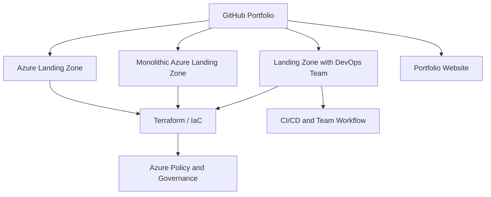

 

---

## 👋 About Me

I am an **AZ-400 certified Azure DevOps Engineer with 15+ years of IT infrastructure experience (since 2011)**, including **7+ years of hands-on Azure experience** across hybrid (on-premises data centre + Azure) environments. Azure operations since 2019, and Azure DevOps, Infrastructure as Code, CI/CD, GitOps and DevSecOps since 2022.

- 🏗️ Design and manage **Azure Landing Zones across 12 subscriptions** with hub-and-spoke networking and Azure Policy governance
- 🔄 Maintain **20 Azure DevOps and GitHub Actions pipelines** using YAML templates (validate, build, deploy, apply, rollback)
- 🖥️ Manage **500+ VMs across DC, DR and UAT** with monthly patching at 95%+ compliance
- 👥 Lead a **team of 4** within an 11-member infrastructure team
- ⚡ Reduced deployment cycles by **up to 65%** and automated **80%** of manual provisioning

📍 Mumbai, India · Open to Azure DevOps, DevSecOps, Cloud and Platform Engineering opportunities.

## 📊 Impact at a Glance

| 🚀 Deployment cycles | 🏢 Azure subscriptions | 🖥️ VMs managed | 🤖 Provisioning automated | 🔧 Pipelines |
|:---:|:---:|:---:|:---:|:---:|
| **↓ 65%** | **12** | **500+** | **80%** | **20** |

## 🧭 Portfolio Delivery Map

## 🧰 Technology Stack

| Domain | Skills and tools |
|---|---|
| ☁️ **Cloud & Infrastructure** | Microsoft Azure, Azure Landing Zones, Management Groups, Cloud Adoption Framework, Load Balancer, Azure Backup, Azure Site Recovery, Linux, Windows Server, VMware, Hyper-V, Nutanix |
| 🌐 **Networking** | VNet, Subnets, Route Tables, Hub-and-Spoke, VNet Peering, UDR, NSG, Azure Firewall, Private Endpoint, Private DNS, VPN, ExpressRoute |
| 🪪 **Identity & Access** | Microsoft Entra ID, RBAC, Managed Identity, Conditional Access, Defender for Cloud |
| 🏗️ **IaC & Automation** | Terraform (reusable modules, remote state, drift detection), ARM/Bicep, Azure Automation, Azure CLI, PowerShell, Bash, Python |
| 🔄 **CI/CD & DevOps** | Azure DevOps, GitHub Actions, GitOps, YAML Pipeline Templates, Branch Policies, Code Owners, Trunk-Based Branching, Azure Repos, Azure Boards |
| 📦 **Containers** | AKS, Kubernetes, Docker, Helm, ACR |
| 🔐 **Security & Compliance** | Azure Policy, Azure Key Vault, tfsec, TFLint, Checkov, SonarQube, TruffleHog, Super Linter, Terratest |
| 🌍 **Azure PaaS & Edge** | App Service, Function Apps, API Management, Application Gateway, Front Door, WAF, Data Factory |
| 🚚 **Migration, DR & FinOps** | Cloud migration (discovery, readiness, cutover, hypercare), Backup and DR (GRS/ZRS, RTO/RPO), right-sizing, auto-shutdown, Reserved Instances |
| 📊 **Monitoring** | Azure Monitor, Log Analytics, Application Insights, Prometheus, Grafana, OpenCost |
| 🔌 **Integration** | Azure Functions, Logic Apps, Service Bus, Event Grid |

## 💼 Experience

| Period | Role | Highlights |
|---|---|---|
| **Sep 2022 – Present** | DevOps Engineer, Hitachi Systems India | Azure Landing Zones, Terraform modules, 20 CI/CD pipelines, hybrid DC/DR/UAT operations, FinOps |
| **Feb 2022 – Sep 2022** | Senior Consultant, Clover Infotech | Hybrid Hyper-V/Nutanix, Azure VMs/VNets, Azure Policy, Entra ID, Key Vault |
| **Apr 2019 – Feb 2022** | Senior Project Engineer, Wipro | Azure L1 operations, Hyper-V clusters, Active Directory, 8,000+ mailboxes |
| **Feb 2013 – Apr 2019** | System Administrator, Sidharth Polysacks | LAN/WAN, FortiGate, Windows Server, 500+ users |
| **2011 – 2013** | System Engineer / Admin | Windows, networking, firewall, Active Directory |

## 🏅 Certifications

- 
- 

## 🚀 Featured Projects

### 1. 🏢 Azure Landing Zone
Terraform-based Azure Landing Zone project covering the foundation for governed Azure environments.

[**Explore →**](https://github.com/shekh-mohammed-imran/Azure-Landing-Zone)

### 2. ☁️ Monolithic Azure Landing Zone
Azure Landing Zone built as a single consolidated configuration, demonstrating the core building blocks end to end.

[**Explore →**](https://github.com/shekh-mohammed-imran/Monolethic-Azure-Landing-Zone)

### 3. 👥 Landing Zone with DevOps Team
Terraform (HCL) project extending the landing zone with a DevOps team structure and workflow.

[**Explore →**](https://github.com/shekh-mohammed-imran/Landing_Zone_With_Devops_Team)

### 4. 🌐 Portfolio Website
Personal portfolio website, live at [imranai.in](https://imranai.in).

[**Explore →**](https://github.com/shekh-mohammed-imran/Imran-s-Portfolio)

> 💡 Repositories are portfolio and learning projects. Each repository's README describes what is implemented versus planned.

## 🏆 Key Achievements

- Reduced deployment cycles by **65%** through Azure DevOps CI/CD modernisation
- Standardised Azure governance across **12 subscriptions** using Landing Zones and Azure Policy
- Led migration of **30 on-premises applications** to Azure with 99.9% uptime and **40% infrastructure cost reduction**
- Automated **80%** of manual provisioning with Terraform and PowerShell
- Implemented **GitOps** workflows for deployment consistency and governance
- Supported a banking platform while maintaining **99% SLA compliance**

## 🔒 How I Approach DevSecOps

- **Automate infrastructure:** version-controlled, repeatable and reviewable cloud configuration.
- **Build quality gates:** tfsec, TFLint, Checkov, SonarQube, TruffleHog and Super Linter in pipelines.
- **Protect credentials:** Azure Key Vault and Managed Identity instead of hard-coded secrets.
- **Apply least privilege:** RBAC reviews and controlled network exposure before deployment.
- **Govern at scale:** Azure Policy and policy-as-code across subscriptions.
- **Make changes safely:** inspect Terraform plans, enforce branch policies and mandatory PR reviews.
- **Control cost:** right-sizing, auto-shutdown, idle resource clean-up and reserved capacity.

## 🎯 Current Focus

- Reusable Terraform modules with policy-as-code
- GitOps workflows and pipeline security
- AKS, Helm and Kubernetes deployment patterns
- Observability with Azure Monitor, Prometheus and Grafana

## 📈 GitHub Stats

## 🎓 Education & Languages

- **MBA (PGDBA)**, Welingkar University, Mumbai (2014)
- **M.A.**, Rajasthan University, Jaipur (2009)
- **Languages:** English (Professional), Hindi (Native)

## 🤝 Connect

I welcome conversations about Azure DevOps, Terraform, CI/CD automation, DevSecOps and cloud infrastructure opportunities.

