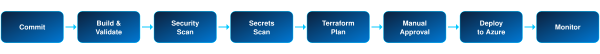

 

 

## 👨‍💻 About Me

> **I build and govern the Azure platforms and pipelines that let teams ship fast, and ship safely.**

I'm an **AZ-400 certified Azure DevOps Engineer** with **15+ years of IT infrastructure experience (since 2011)** and **7+ years of hands-on Azure**, across hybrid (on-premises data centre + Azure) environments. I have worked on Azure operations since 2019, and on **Azure DevOps, Infrastructure as Code, CI/CD, GitOps and DevSecOps since 2022**. I use **Terraform, ARM/Bicep, Azure DevOps and GitHub Actions** to build repeatable, governed platforms, reducing deployment cycles by **up to 65%** and automating **80% of manual provisioning**.

<table>
<tr>
<td width="33%" valign="top">

### ⚙️ Automate
Reusable Terraform modules (remote state, drift detection), ARM/Bicep, and scripted operations in PowerShell, Bash, Python and Azure CLI.

</td>
<td width="33%" valign="top">

### 🚀 Deliver
**20 pipelines** across Azure DevOps and GitHub Actions using YAML templates (validate, build, deploy, apply, rollback), with GitOps and AKS workloads.

</td>
<td width="33%" valign="top">

### 🛡️ Secure
tfsec, TFLint, Checkov, SonarQube and TruffleHog in the pipeline, plus Azure Policy, Defender for Cloud, Entra ID and Key Vault.

</td>
</tr>
</table>

## 🧰 Tech Stack

**🔄 CI/CD & Version Control**

**🏗️ Infrastructure as Code & Containers**

**☁️ Cloud Platform**

**🐍 Scripting & Automation**

**📊 Monitoring & Operations**

**🌍 Azure PaaS & Integration**

**🔐 DevSecOps & Security**

**🖥️ Systems & Hybrid Infrastructure**

**🏅 Certifications**

## 🏛️ Cloud Architecture & Governance

<table>
<tr>
<td width="50%" valign="top">

### 🧭 Enterprise Landing Zones (CAF)
Azure Landing Zones aligned to the Cloud Adoption Framework, standardised across **12 subscriptions**.

- **Management Group** hierarchy and subscription design
- Governance policies and **Azure Policy** at scale
- RBAC and least-privilege access
- Policy-as-code with reusable Terraform modules

</td>
<td width="50%" valign="top">

### 🌐 Hub-and-Spoke Networking
Shared connectivity with centralised inspection and controlled egress.

- Hub VNet with spoke **VNet peering**, route tables and UDRs
- **Azure Firewall** and NSGs
- **Private Endpoints** and Private DNS
- VPN and **ExpressRoute** to the data centre

</td>
</tr>
<tr>
<td width="50%" valign="top">

### 🪪 Identity & Access
**Microsoft Entra ID**, **RBAC**, **Managed Identity** and **Conditional Access**, enforcing least privilege across environments.

</td>
<td width="50%" valign="top">

### 🛡️ Defence in Depth
Security applied at the **identity, network, governance and secrets** levels, with Defender for Cloud, Azure Policy and Key Vault as guardrails.

</td>
</tr>
</table>

## 🏗️ Terraform & Pipeline Practices

<table>
<tr>
<td width="50%" valign="top">

### 🧱 Terraform Automation
- Reusable modules, **remote state** and **drift detection**
- Terraform **security reviews** with tfsec, TFLint, Checkov, SonarQube, TruffleHog and Super Linter
- Terratest for module testing
- Policy-as-code that cut compliance review time

</td>
<td width="50%" valign="top">

### 🔁 Azure Repos, GitHub & Pipelines
- **Trunk-based** branching, branch policies, code owners and mandatory PR reviews
- GitFlow established across GitHub and Azure Repos, reducing merge conflicts
- YAML templates: **Validate, Build, Deploy, Apply, Rollback**
- Azure Boards for sprint planning and work-item tracking

</td>
</tr>
</table>

## ☁️ Migration, Resilience & Cost

<table>
<tr>
<td width="33%" valign="top">

### 🚚 Cloud Migration
Discovery, readiness, **cutover and hypercare**. Led a team of 4 to migrate **30 on-premises applications** to Azure with **40% lower infrastructure cost** and 99.9% uptime, using monitoring, alerting and Service Bus.

</td>
<td width="33%" valign="top">

### 🔄 Backup, DR & HA
Azure Backup and Site Recovery, **GRS / ZRS**, RTO / RPO planning. Owning **DC, DR and UAT** environments with **500+ VMs** patched monthly at 95%+ compliance.

</td>
<td width="33%" valign="top">

### 💸 FinOps & Monitoring
Idle resource removal, right-sizing, auto-shutdown and reserved capacity. **Azure Monitor**, Log Analytics, Prometheus and Grafana, maintaining **99% SLA** on a banking platform.

</td>
</tr>
</table>

## 🔄 My CI/CD Delivery Flow

## 🚀 Featured Projects

<table>
<tr>
<td width="50%" valign="top">

### 🏢 Azure Landing Zone
Terraform-based foundation for governed Azure environments.

[**View repository →**](https://github.com/shekh-mohammed-imran/Azure-Landing-Zone)

</td>
<td width="50%" valign="top">

### ☁️ Monolithic Azure Landing Zone
A single consolidated configuration demonstrating the core landing zone building blocks end to end.

[**View repository →**](https://github.com/shekh-mohammed-imran/Monolethic-Azure-Landing-Zone)

</td>
</tr>
<tr>
<td width="50%" valign="top">

### 👥 Landing Zone with DevOps Team
Terraform (HCL) project extending the landing zone with a DevOps team structure and workflow.

[**View repository →**](https://github.com/shekh-mohammed-imran/Landing_Zone_With_Devops_Team)

</td>
<td width="50%" valign="top">

### 🌐 Portfolio Website
Personal portfolio website, live at [imranai.in](https://imranai.in).

[**View repository →**](https://github.com/shekh-mohammed-imran/Imran-s-Portfolio)

</td>
</tr>
</table>

> 💡 These repositories are portfolio and learning projects. Each repository's README describes what is implemented versus planned.

## 💼 Experience Highlights

| 🗓️ Period | 🏢 Company | 🎯 What I did |
|---|---|---|
| **Sep 2022 – Present** | **Hitachi Systems India** (DevOps Engineer) | Azure Landing Zones across 12 subscriptions with hub-and-spoke networking · Reusable Terraform modules that cut deployment cycles by 65% · 20 Azure DevOps and GitHub Actions pipelines with branch policies and PR reviews · Azure PaaS and edge: App Service, APIM, Application Gateway, Front Door, WAF, Data Factory · Patched 500+ Linux and Windows VMs monthly · Terraform security reviews and FinOps · Led a team of 4 |
| **Feb 2022 – Sep 2022** | **Clover Infotech** (Senior Consultant) | Hybrid Hyper-V / Nutanix environments · Azure VMs, VNets, NSGs, VPNs and Azure Policy · Entra ID RBAC and Conditional Access · Key Vault · PowerShell and Azure CLI automation |
| **Apr 2019 – Feb 2022** | **Wipro** (Senior Project Engineer) | Azure L1 operations (Resource Groups, VMs, VNets, NSGs, Storage, Backup checks) · Hyper-V clusters at 99.9% uptime · Active Directory and Exchange for 8,000+ mailboxes |
| **Feb 2013 – Apr 2019** | **Sidharth Polysacks** (System Administrator) | LAN/WAN, FortiGate firewalls, Windows Server, Active Directory and Google Workspace for 500+ users |
| **2011 – 2013** | **Raj Solution / Precision Techserve** | Windows, networking, firewall, Active Directory and endpoint administration |

## 🧠 How I Think About DevOps & DevSecOps

- ⚙️ **Automate everything repeatable:** infrastructure, patching and operational workflows as code.
- 🧱 **Standardise:** reusable Terraform modules and pipeline templates so every team starts from a good baseline.
- 🔍 **Shift left:** tfsec, TFLint, Checkov, SonarQube and TruffleHog run in the pipeline, before deployment.
- 🔄 **Release safely:** reviewed plans, branch policies, mandatory PR reviews and rollback stages.
- 📊 **Keep it reliable:** monitoring and alerting with Azure Monitor, Log Analytics, Prometheus and Grafana.
- 💸 **Control cost:** right-size, auto-shutdown, remove idle resources and review reserved capacity.

## 🤝 Delivery & Collaboration

Beyond the code, I care about how work gets delivered: leading a **4-member team** inside an 11-member infrastructure team, sprint planning and work-item tracking in **Azure Boards**, closing Information Security vulnerability findings, and escalating issues with logs and evidence.

## 🎯 Currently Focused On

- 🔄 GitOps workflows and pipeline security
- 🧩 Reusable Terraform modules with policy-as-code
- ☸️ AKS, Helm and Kubernetes deployment practices
- 📈 Observability with Azure Monitor, Prometheus and Grafana

## 🎓 Education & Languages

- **MBA (PGDBA)**, Welingkar University, Mumbai (2014)
- **M.A.**, Rajasthan University, Jaipur (2009)
- **Languages:** English (Professional), Hindi (Native)

## 📫 Let's Connect

I'm open to **Azure DevOps, DevSecOps, Cloud and Platform Engineering** roles. If you're building on Azure and want reliable, automated and governed delivery, let's talk.

📍 **Mumbai, India**

 

