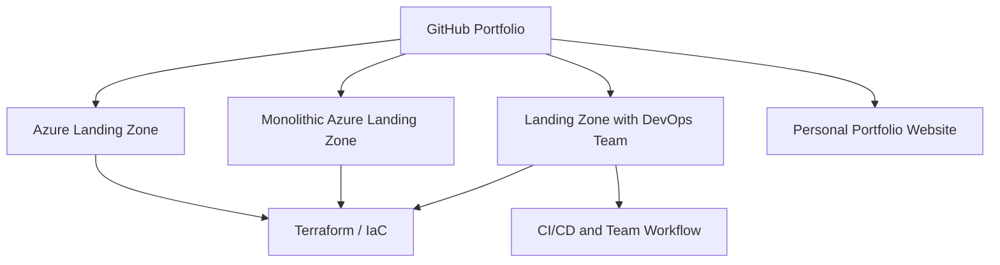

### ☁️ Azure DevOps Engineer | Microsoft Azure | Terraform | CI/CD

**Cloud Infrastructure · Automation · Security · Reliability**

---

## 👋 About Me

I am an **AZ-400 certified Azure DevOps Engineer with 15+ years of overall IT experience**, including **6+ years focused on Azure cloud, Infrastructure as Code, CI/CD automation, GitOps and DevSecOps**, based on the professional summary on my LinkedIn profile. My focus is building repeatable infrastructure, improving delivery workflows, and bringing security and governance checks earlier into the delivery lifecycle.

I work with **Microsoft Azure, Terraform, ARM/Bicep, Azure DevOps, GitHub Actions, AKS/Kubernetes, Azure Landing Zones, Azure Policy, Azure Monitor and cloud security tooling**. My earlier background in enterprise infrastructure and systems administration supports strong platform-level troubleshooting. My portfolio documents hands-on learning and implementation work; each repository describes what is currently implemented versus planned.

📍 Based in Mumbai, India · Open to relevant DevOps, DevSecOps, Azure Cloud, Platform Engineering, and Infrastructure as Code opportunities.

## 🧭 Portfolio Delivery Map

## 🧰 Technology Stack

| Domain | Skills and tools |
|---|---|
| ☁️ **Cloud & Networking** | Microsoft Azure, Azure Landing Zones, Virtual Networks, NSGs, Load Balancer, VPN, RBAC, Managed Identity, Azure Backup, Azure Site Recovery, Azure Key Vault |
| 🏗️ **Infrastructure as Code** | Terraform, ARM/Bicep, reusable modules, policy-as-code, Azure Automation, Azure CLI |
| 🔄 **CI/CD & Automation** | Azure DevOps, GitHub Actions, GitOps, Azure Repos, Azure Boards, GitFlow, build and deployment workflows |
| 🔐 **DevSecOps & Governance** | Azure Policy, secrets management, least privilege, Terraform security reviews, tfsec, TFLint, TruffleHog, Super Linter, Terratest |
| 📦 **Containers & Orchestration** | AKS, Kubernetes, Docker, Helm, ACR |
| 🐧 **Systems & Scripting** | Linux, Windows Server, VMware, Hyper-V, Bash, PowerShell, Python, Git |
| 📊 **Monitoring & Observability** | Azure Monitor, Log Analytics, Application Insights, Prometheus, Grafana, OpenCost |
| 🔌 **Integration & Messaging** | Azure Functions, Logic Apps, Service Bus, Event Grid |
| 🧠 **Operations mindset** | Troubleshooting, monitoring and alerting, change review, documentation, cost and security awareness |

## 🏅 Microsoft Certifications

- **AZ-400** — Designing and Implementing Microsoft DevOps Solutions
- **AZ-104** — Microsoft Azure Administrator

## 🚀 Featured Projects

### 1. 🏢 Azure Landing Zone
Terraform-based Azure Landing Zone project covering the foundation for governed Azure environments. Review the repository for current scope and limitations.

[**Explore Azure Landing Zone →**](https://github.com/shekh-mohammed-imran/Azure-Landing-Zone)

### 2. ☁️ Monolithic Azure Landing Zone
Azure Landing Zone built as a single, consolidated configuration to demonstrate the core building blocks end to end. Assess the actual configuration in the repository before treating it as production-ready.

[**Explore Monolithic Azure Landing Zone →**](https://github.com/shekh-mohammed-imran/Monolethic-Azure-Landing-Zone)

### 3. 👥 Landing Zone with DevOps Team
Terraform (HCL) project that extends the landing zone with a DevOps team structure and workflow.

[**Explore Landing Zone with DevOps Team →**](https://github.com/shekh-mohammed-imran/Landing_Zone_With_Devops_Team)

### 4. 🌐 Personal Portfolio Website
HTML portfolio website.

[**Explore Portfolio Website →**](https://github.com/shekh-mohammed-imran/Imran-s-Portfolio)

## 🔒 How I Approach DevSecOps

- **Automate infrastructure:** keep cloud configuration version-controlled, repeatable, and reviewable.
- **Build quality gates:** validate Terraform, lint configuration, and scan IaC and secrets with tools such as tfsec, TFLint, TruffleHog and Super Linter.
- **Protect credentials:** avoid hard-coded secrets, use Azure Key Vault, and prefer Managed Identity where supported.
- **Apply least privilege:** review RBAC permissions and network exposure before deployment.
- **Govern at scale:** use Azure Landing Zones and Azure Policy to keep subscriptions consistent.
- **Make changes safely:** inspect Terraform plans, understand resource impact, and require review before sensitive changes.
- **Document honestly:** distinguish tested implementation from roadmap items and avoid claiming production readiness without evidence.

## 🎯 Current Focus

- Improving reusable Terraform modules and environment separation.
- Strengthening CI/CD pipeline security and GitOps workflows.
- Improving network segmentation and Azure governance.
- Practising AKS, Helm and Kubernetes deployment workflows.
- Publishing clear project documentation and validation evidence.

## 🤝 Connect

I welcome conversations about Azure DevOps, DevSecOps, Terraform, CI/CD automation, and cloud infrastructure opportunities.

